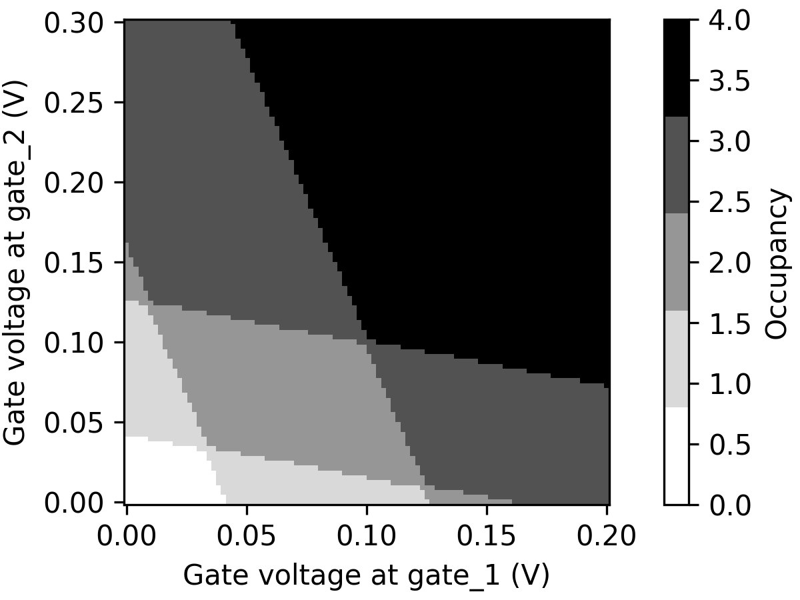
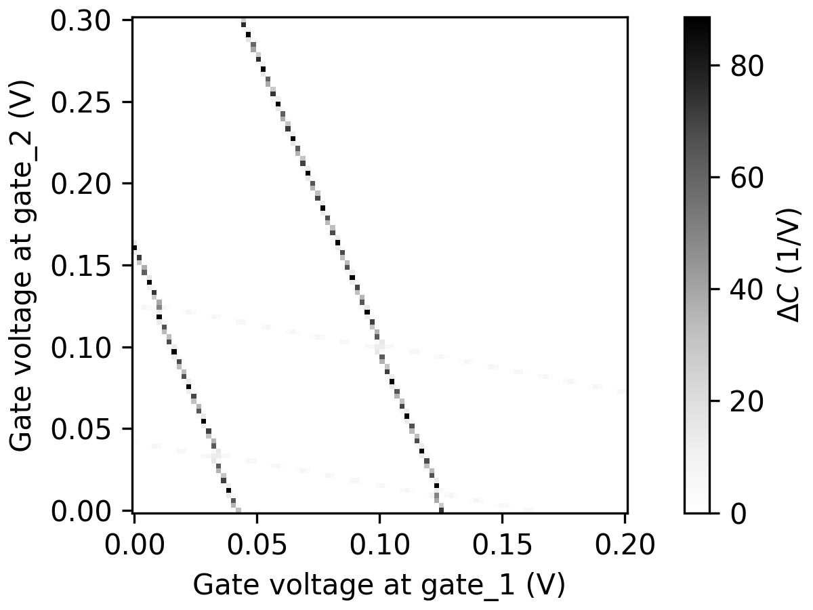

# RF-Squad: A radiofrequency simulator for quantum dot arrays

RF-Squad is a physics-based simulator designed to realistically replicate radiofrequency (RF) reflectometry measurements of quantum dot arrays.

This implementation only consists of the constant interaction model layer.

See full paper on arxiv: [RF-Squad: A radiofrequency simulator for quantum dot arrays](https://arxiv.org/abs/2511.11504)

## Installation

1. Clone the repository

   ```sh
   git clone xyz
   ```

1. Install `rfsquad` and its dependencies with poetry:

   ```sh
   poetry env use python3.12
   poetry install
   ```

   This installs `rfsquad` in virtual environment called something akin to `rfsquad-some-hash-py3.12`. `rfsquad` supports python 3.11 and above.

   Alternatively you can use conda+pip, venv+pip or any other modern installation method.

## Getting started

The following snippet shows how to create a double quantum dot `Device` from dot-dot and dot-gate capacitance matrices, pass it to the solver (`CISolver`) and calculate and plot the occupancy charge stability diagram

```python
from rfsquad.core import Device
from rfsquad.solvers import CISolver
from rfsquad.csd import OccupancyDiagram, EnergyDiagram

import jax.numpy as jnp

device = Device(
    C_dd=jnp.array([[20, -0.5], [-0.5, 20]]), C_dg=jnp.array([[1.9, 0.5], [0.5, 1.9]])
)

ci = CISolver(device)

sweep = {"gate_1": jnp.linspace(0, 0.2, 100), "gate_2": jnp.linspace(0, 0.3, 100)}

csd = ci.run(sweep, max_charge_carriers=2)
occ = OccupancyDiagram(csd)
plot = occ.plot()
```



### RF measurements

You can also use the `RFSolver` to calculate the simulated RF response:

```python
import jax.numpy as jnp

from rfsquad.core import Device
from rfsquad.solvers import RFSolver

device = Device(
   C_dd=jnp.array([[20, -0.5], [-0.5, 20]]),
   C_dg=jnp.array([[1.9, 0.5], [0.5, 1.9]]),
)
ci = RFSolver(device, max_charge_carriers=2
sweep = {"gate_1": jnp.linspace(0, 0.2, 100), "gate_2": jnp.linspace(0, 0.3, 100)}

csd = ci.run(sweep, temperature=0.3, sensor_gate="gate_1")
plot = csd.plot()
```


